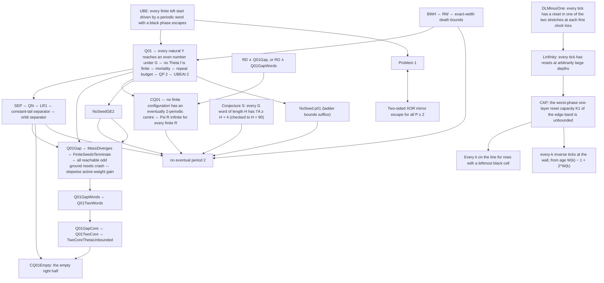

<!-- kit-commit: b5b9dbd 2026-11-22 -->
# The Rule 30 Prize kit, in one reading

*What is already proved, what is open, and how the open statements connect. Written from the kit at commit `b5b9dbd` (main, 2026-11-22),
the commit in the stamp line above, and kept in step with the kit's main by [KIT-UPDATE.md](KIT-UPDATE.md). One line
per catalogue row, with contributors, is in [KIT-INDEX.md](KIT-INDEX.md). Everything below is the kit's claim; check
the Lean source before building on it.*

The kit is [WolframInstitute/Rule30PrizeKit](https://github.com/WolframInstitute/Rule30PrizeKit): Lean 4.35.0 with
Mathlib `v4.35.0`, 293 modules under `lean/` (41 of them certificate data) and 108 under `equivalents/`. Every theorem
uses only `propext`, `Classical.choice` and `Quot.sound`. The submissions portal held 395 entries on 22 November
(393 Lean-verified); its verifier checks against the kit commit in its own `environment.kit.commit`, which lags main.

## 1. The problems

```lean
def rule (a b c : Bool) : Bool := xor a (b || c)
def cell : Nat → Int → Bool                       -- single black cell at 0, time 0
  | 0, p => decide (p = 0)
  | t + 1, p => rule (cell t (p - 1)) (cell t p) (cell t (p + 1))
def EventuallyPeriodic (f : Nat → Bool) : Prop := ∃ T P : Nat, 0 < P ∧ ∀ t, T ≤ t → f (t + P) = f t
def center (t : Nat) : Bool := cell t 0
def Problem1 : Prop := ¬ EventuallyPeriodic center
def Problem2 : Prop := ∀ k : Nat, 0 < k → ∃ N, ∀ n, N ≤ n → k * (2 * (blackCount n : Int) - n).natAbs ≤ n
-- Problem 3 (Rule30Problem3): no one-tape Turing machine reading n's binary digits, least significant first,
-- computes center n in time O(n). Problem3 ⇒ Problem3Verbal (o(n)) ⇒ Problem3Robust (n^o(1)) ⇒ Problem1.
```

All three are open. Every result in the kit is partial.

## 2. Where each case stands

| Case | Status |
|---|---|
| Period 1 | **Proved** for every column, and for every configuration with a leftmost black cell. |
| Small periods | **Proved:** no eventual period P ≤ 4096 with transient ≤ 8192 (`Rule30Window`); any eventual period has T + P ≥ 16359 (`Rule30FactorWindow`). |
| Period 2 | Reduced to statements about the zero-boundary left half (Q01 and weaker forms, §3). All **open**. Q01 is proved for every start of width ≤ 52. |
| Least period 3 | Reduced: 001 needs Q001 or C3s001, 011 needs C3w(011). All **open**. AbsorptionT t001 is **false**. The ether-and-wall route is closed: the 12 × 3 ether has no wall of any width. |
| Least period 4 | Reduced to Absorption, and to the weaker Lock, for each of 0001, 0011, 0111. Both **open**. The pure ether lies in no trap of width ≤ 20; single-cell and high-support absorption are proved. |
| Longer periods | **Open.** Large families of repeating words are excluded (§5). |
| Problem 2 | **Open.** Many equivalent forms and sufficient conditions (§6); unconditional density bounds are weak (§5). |
| Problem 3 | **Open.** Unconditionally, every machine computing the centre takes at least k + 1 steps infinitely often, for each k ≤ 13 (`Rule30Problem3Bounds`). |

## 3. The web of open statements

Arrows are proved implications; a statement inside one box is proved equivalent to the others in it. Every box is
open unless marked.



**Period 2, in words.**
- `Rule30PeriodTwo`, `Rule30PeriodTwoCoupled`: Q01 ⇒ CQ01 ⇒ no eventual period 2. `Rule30ZeroBoundary`: Q01 ⇔ the
  Theta form ⇔ the integer form ⇔ bounded and staged forms. `Rule30FrontierChart`: Q01 ⇔ mortality ⇔ repeat budget.
- `Rule30SeparatorQ01`: Q01 ⇔ SEP ∧ the case of free bits with two adjacent whites; SEP ⇒ Q01Gap, SEP ⇒ CQ01Empty;
  BWH ⇒ Q01. `Rule30WedgeBridge`: BWH ⇔ RW. `Rule30SEPToPeriodTwo`: SEP, RW, BWH each exclude a period-2 centre trace on
  finite rows. Open: whether SEP ⇒ Q01, or Q01 ⇒ RW.
- `Rule30GateTrap`: Q01 ⇒ Q01Gap ⇒ CQ01Empty (black cells of u ∅ come 3 or 5 double steps apart after step 146).
  `Rule30GateTrapWords`, `Rule30GateTrapLift`: Q01Gap ⇒ Q01GapWords ⇒ Q01GapCore ⇒ CQ01Empty; the gap words 333, 3353,
  3533, 3553, 5533 and 3535353 are excluded after trap entry. `Rule30ZeroCoastBridge`: MassDiverges ⇔ Q01Gap, and the seeds surviving the gap language to horizon H number N(H)
  with N(H + 10) = N(H + 4) + N(H) exactly. Q01Gap is also equivalent to eventual termination of the forced zero-bit continuation from every surviving prefix (`q01Gap_and_massDiverges_iff_survivingSeeds_void_crash`); it suffices to check macro-step termination at every reachable odd-horizon age-zero reset (`q01Gap_and_massDiverges_iff_reset_iterVoidMacro_crash`). Equivalently, survivor popcount bounds the horizon (`massDiverges_and_q01Gap_iff_survivingSeeds_konig`), or from every horizon some finite step raises every survivor's active weight by at least one (`q01Gap_and_massDiverges_iff_stepwise_wtH_increment`); one uniform crash lookahead would prove Q01Gap (`void_schedule_telescoping_weight_bound_and_q01Gap_iff`).
- `Rule30PeriodTwoWidth13`: under an alternating centre the left trace lies in GE2; Q01 ⇒ NoSeedGE2 ⇒ no period 2;
  RD ∧ Q01Gap ⇒ CQ01. `Rule30ZeroCoastBridge` embeds the gap language in GE2, so NoSeedGE2 ⇒ MassDiverges ⇔ Q01Gap. `Rule30PeriodTwoMass`: Conjecture S ⇒ no period 2, sharp at 86. `Rule30PeriodTwoLadder`: the mean
  ladder law is an exact fair-coin count; geometric ladder bounds ⇒ NoSeed p01. `Rule30PeriodTwoNoFloor`: no uniform
  floor H ≤ qA + d with q < 14 (**refuted** by eternal periodic rows).
- `Rule30ZeroBoundaryPeriodLanes`: QP P generalises Q01 (QP 2 ⇔ Q01, QP 3 ⇔ Q001); QP P excludes (0^(P−1) 1)^∞;
  P ∣ Q and QP Q ⇒ QP P; QP 4 ⇒ Q01 ∧ C3 w0001.
- During centre alternation, returns of the word 0101001 at sites −4 through +2 take a multiple of four ticks, six
  ticks, or ten ticks. A gap ≥ 12 forces the next gap to be six, and ten forces four, if alternation continues.
  An alternating singleton tail has arbitrarily late returns in both white phases modulo four (`Rule30EventReturns`).

**Period 3** (`Rule30EtherThreeLeft`, `Rule30EtherThreeSkeleton`, `Rule30PeriodThreeLanguage`). Q001 ∧ C3w(011) ⇒ no
eventual period 3; C3w(001) ∧ C3w(011) ⇒ no period 3; C3w(001) ⇒ C3s001 ⇒ not eventually 001; C3w(011) ⇒ C3r011;
C3r011 ∧ C3g001 ⇒ no period 3. AbsorptionT t001 is **false** (`Rule30EtherThreeNotAbsorption`: a period-15 trap apart
from t001 holds a right half for ever), so 001 needs a weaker entry statement.

**Period 4** (`Rule30Ether`, `Rule30PeriodFourSkeleton`). Absorption w ⇒ Lock w ⇒ not eventually w, for w = 0001,
0011, 0111; the three Locks ⇒ no least period 4. C3 ⇒ (period 4 ⇒ period 2). Problem2 ⇒ not eventually 0001 or 0111,
and no odd eventual period. The finite left half is necessary (`Rule30EtherWallWitness`).

**Inverse ticks at the wall** (`Rule30EveryKStatement`, `Rule30EveryKCascade`, `Rule30EveryKInverse`). CAP ⇒ for
every k, every k-tick predecessor of an aged nonzero finite row is finite with its edge exactly k inside, and every
cell-1 history occurs, from age W(k) − 1 + 2^W(k), where W(k) is the least width of capacity k
(`conditional_every_k`); any proved settling age may replace that bound (`capacity_at_settling_age`). CAP is open.
The target holds at k = age = 0 and persists as age increases. Positive multiples of a cycle period give the same schedule and phase capacity. The target needs age at least 2k (`Rule30ZeroCoastBridge`).
On every pointed recurrent strip, let a reset be a closed run 0 1^(3m+1) 0. If every tick has a reset between the
white wheel at each first clock loss and the white wheel after next (`DLMinusOne`), every tick has arbitrarily deep
resets (`LInfinity`). Compactness then gives CAP (`Rule30RelaxedWindows`, `Rule30ResetCompactness`). The two-stretch
hypothesis remains open. On the whole line, if w>0 and k≤K1(w), every k-tick predecessor of a row
with a leftmost black cell has its edge k sites inside from age 2^w (`Rule30EveryKLine`). Ages 8 and 24 suffice
unconditionally at depths one and two, and age 7 fails at depth one (`Rule30TwoSidedInverse`).

**Other routes to Problem 1.**
- For every tail start and shift P ≥ 2, compare the single-seed diagram with its P-tick translate. Problem 1 is equivalent to an initial centre mismatch or a later failure of the mirror rule: at a black centre the left neighbour must match, and at a white centre the two neighbour differences must agree (`problem1_iff_two_sided_xor_mirror_escape`).
- The coupled family (`Rule30Coupled`): CQ ω ⇔ no finite configuration has centre ω; CQ ω for every periodic ω with
  a black cell ⇒ Problem 1, with reductions to half-balanced even periods under Problem 2.
- Observability (`Rule30TraceEdge`, `Rule30DividedDifference`): ObserverCriterion ⇒ EdgeObservable ⇒ Problem 1;
  Problem 1 ⇔ SeedTraceShiftFree. Edge recovery from finite trace windows fails (`Rule30TraceAmbiguity`).
- The left edge (`Rule30AperiodicBand`): an aperiodic band from column 0 at every depth ⇒ Problem 1; bands are proved
  to depth 87,868 for long periods.
- Density along progressions (`Rule30LeftAntiPeriod`): half density along dyadic progressions ⇒ Problem 1; Problem 2 ⇒
  no odd eventual period.
- Words (`Rule30StripCertificates`): Problem 1 ⇔ no finite word is an eventual tail.
- Problem 3 ⇒ Problem 1 (`Rule30Problem3`, `Rule30Problem3Bounds`); UBE ⇒ Problem 1 (`Rule30BlackPhaseEscape`); the
  frozen-boundary conjecture ⇒ Problem 1 (`equivalents/`).

## 4. Barriers: what cannot work

- **Structure alone is not enough.** Rules 90, 150 and 210 satisfy every structural fact the arguments use, yet their
  centre columns are eventually constant (`Rule30Realization`). Rules 90 and 150 beside a wall have exact, sharp Q01
  deadlines (`Rule30WallDeadlines`). For planting depth L ≥ 1, the survivor count through time t at width ≤ W equals
  rule 30's plus one exactly when W ≥ 2L−1 and t ≥ 2⌈W/2⌉. It equals rule 30's elsewhere
  (`Rule30PlantedSurvivor`). Radius-2 left permutivity allows periodic columns (`Rule30RadiusTwoClock`).
  An alternating 90/150 hybrid has immortal finite rows (`Rule30HybridWall`).
- **No ranking.** No ranking through a finite abstraction, no local ranking, no edge-DFA ranking proves Q01
  (`Rule30ZeroBoundaryBarriers`); no well-founded rank of width and a finite-monoid image (`Rule30RecognizableBarrier`);
  no additive ranking bounded below on late rows (`Rule30FreeMiddle`); no finite abstract ranking in the coupled frame
  (`Rule30PeriodTwoSideways`).
- **No conserved quantity.** Densities conserved by rule 30 on closed walks are constants plus shift coboundaries, also
  with parity coefficients (`Rule30LocalConservation`, `Rule30ProductParity`); an autonomous local observable is
  constant (`Rule30LocalFactor`).
- **No linear chart.** Theta is affine only to depth 6; a linear chart of the constrained starts is the free-bit chart
  (`Rule30LinearCharts`); the cone tip is not affine (`Rule30ConeTip`).
- **The finite hypothesis matters.** A periodic left half can realise period-4 and alternating centres
  (`Rule30EtherWallWitness`); infinite rows can share an entire centre trace (`Rule30TraceMerge`,
  `Rule30FeedbackErasure`); InX rows with equal images need share no tail (`Rule30UnrestrictedClosing`).
- **Late observations.** Beside an alternating singleton centre, a one-in-five pattern of black right-neighbour
  readings on white ticks for n updates starting at age b≥31 requires 35n<27b+2478 in every phase (`Rule30LateObservation`).
  Under any proposed singleton centre period, matching future left windows and clock phase can hide the previous
  right bit. A reader recovering it on the singleton would prove Problem 1 (`Rule30PastSwap`).
- **Finite starts can share a growing centre window.** At h = 336q + 97, two starts supported on [−h,h] agree in
  columns 0 through 112q + 26 at every tick from 28 through h, then have opposite centre bits at h + 1. The entire
  right half at age h determines the start under the same support bound (`Rule30HalfAgeOrigin`).

## 5. Unconditional results with reach

- **Constant runs.** A black centre run of length L from time a ≥ 1 has L ≤ a; white runs L ≤ a − 1 (a − 3 for
  a ≥ 3); both colours occur in every window [a, 2a] (`Rule30CenterRuns`); log-log margins
  (`Rule30SettledBarrierEffective`, `Rule30WhiteSpacing`).
- **Right-edge sources.** For any cutoff D ≤ k, the contribution from depths 0 through D to the centre is one at tick
  2^(k+2) − 1 and zero on the next 2^(k+1) − 1 ticks. If the centre repeats its pulse-time reading in that interval,
  deeper-source parities differ (`Rule30EdgeSourcePulse`).
- **Excluded repeating words**, for every transient and usually every column of every configuration with a leftmost
  black cell: 1 0^q and 0^q 1 for q ≥ 9 (`Rule30WhiteEndNine`); any mixture of blocks 1^r 0^q with every q ≥ 17, so
  every nonconstant eventual period has a cyclic white run ≤ 16 (`Rule30White17Runs`); grammar and reset mixtures
  (`Rule30GrammarRuns`, `Rule30ResetMixtures`); every 0^r u with u of at most six bits and r ≥ 74
  (`Rule30SixTailSharpened`); 0^r v 011 for every v once r ≥ 10|v| + 41 (`Rule30SuffixFamilies`); every u 0^q with u
  black-containing, past a bound singly exponential in |u| (`Rule30ArbitraryWhitePadding`); long black runs
  (`Rule30BlackRuns`, `Rule30ParametricStripCertificates`); 30 certified words (`Rule30StripCertificateTable`).
  For the singleton centre, a cyclic word is excluded if a certified run suffix fixes the right neighbour at every
  white phase. Examples have isolated whites and cyclic black-run lengths (9,7,7) or (9,1,8,1,8) (`Rule30RunTransitions`).
- From singleton age T > 0, record black centre ticks as one letter and distinguish the two right-neighbour colours at
  white centre ticks. If a length-n block recurs at a later offset j, then n ≤ T + j. Under centre alternation, sufficiently
  early repeated blocks of 3/5 kick gaps, with no adjacent 3s, force the compatible left row to have infinite support
  (`Rule30GapRepetitions`).
- **The zero-boundary left half.** Q01 for every start of width ≤ 52, death by tick 96 (`Rule30ZeroBoundaryWidth52`);
  stripe-prefix families die (`Rule30ZeroBoundaryStripe*`); every nonzero finite row contains a reset word within
  three ticks (`Rule30ResetFreeThree`); predecessors of aged finite rows are finite (`Rule30AgeEightInverse`,
  `Rule30AgeTwentyFourInverse`); every-k wall histories need age at least 2k, and a band settled at width w has
  age at least 2·K1(w) (`Rule30ZeroCoastBridge`); late twins (`Rule30LateTwins`); swapping the first six- and ten-tick wall returns
  keeps finite width and every row from tick 11 (`Rule30ResetSwap`); every finite wall record has a finite row with a
  complete predecessor tree of exactly any prescribed height (`Rule30WallRecordAncestry`); from check 2 on, two of any three consecutive first checks
  pass a share of rows in [1/40, 39/40], and check n has degree n or n − 1 (`Rule30FirstChecks`, `Rule30FirstCheckDegree`).
- An output with arbitrarily far-right white cells has at most two whole-line predecessors. Every 2k-tick ancestor of a nonconstant spatially p-periodic row is 2^k p-periodic (`Rule30InverseSpatialPeriod`, `Rule30InverseSixBlack`).
- **Gap-language survivors.** If seed y survives to horizon 2m, the number Z of zeros in its trace at times
  0, 2, …, 2m−2 satisfies m ≤ 5Z and 3Z ≤ m+2. The canonical seed count N(H) is nondecreasing and
  N(10k+r) ≥ 2^k for all natural k and r. For H ≥ 17, swapping the initial (6,10) and (10,6) returns pairs the
  corresponding finite-horizon surviving seeds (`Rule30ZeroCoastBridge`).
- **The left edge.** Every configuration with a leftmost black cell eventually matches one of four left sides through
  wheel 87,866 (`Rule30FourLeftSides`); the seed's white left diagonals there are D2, D7, D28, D399, D53207, D58286,
  D87866 (`Rule30SeedLeftSide`); left diagonal j has eventual period dividing 2^j, with reset and front laws
  (`Rule30Diagonals`, `Rule30LeftReset`, `Rule30FrontLaw`). Counted over all nonzero labelled Q-bit first children
  of a white profile, the first return to white takes at most 2^Q + 1 diagonals on average, for every Q > 0; a
  single chain is bounded only by 2^(2Q) (`Rule30TemporalProfiles`).
  On a pointed recurrent strip the least prefix clocks are powers of two. Each fixed triple of consecutive ticks has
  a tick with arbitrarily deep resets (`Rule30RecurrentStrip`, `Rule30ThreePhaseReturn`). A black-edged strip must
  lose each positive clock p by depth 4^p + 1. On pointed recurrent strips, arbitrarily deep permanently white
  wheels have a permanently black wheel two positions further in (`Rule30RootedWhiteReturns`).
- **Right diagonals.** Diagonal j has period 2^B(j) with B(j) = j/2 + O(log* j) (`Rule30RecordCharge`,
  `Rule30RightPeriods`).
- **Density.** Any five adjacent columns hold at most 3T + 2 black cells in any T ticks, sharp (`Rule30FiveColumnBound`);
  the j-th black centre time is at most 20·(8/5)^j − 20, so the first N cells hold about log_(8/5)(N/20) black ones or
  more (`Rule30BlackTimeGrowth`).
- **Jen.** No two columns are both eventually periodic, with masked and finite-configuration forms (`Rule30Jen`,
  `Rule30MaskedJen`, `Rule30FiniteConfigs`, `Rule30FiniteMaskedJen`). On a periodic singleton centre tail with
  isolated white ticks, the stream of selected unpaired spatial 10 sources is aperiodic. If each white is followed
  by two black ticks, the net parity of the three source arrivals and the XOR of columns −2 and +2 are each
  aperiodic (`Rule30SourceArrivals`).
- **Algebra.** The centre after t ≥ 2 steps has degree exactly 2t − 1 over GF(2) (`equivalents/AlgebraicDegree`).

In `Rule30TwoBlockCounts`, a black centre with a white left neighbour takes the value of the cell two places left two ticks later. This gives exact spatial counts for the temporal triples 110 and 111.

## 6. Equivalent forms

`equivalents/` proves 52 of 54 catalogued forms equivalent to Problem 1, as 163 `problem1_iff_*` theorems; the hard
classical one left is Durand's theorem, stated. Among them: x₂ = 0.c(0)c(1)… irrational in any base; the 2-adic number
Σ c(t)2^t irrational; Σ c(t)X^t not rational over F₂ (no LFSR); at least n + 1 factors of every length; not
k-automatic for some k ≥ 2; not both 2- and 3-automatic; Σ c(t)X^t transcendental over F₂(X) or F₃(X); Σ c(t)z^t with
the unit circle as natural boundary; not P-recursive, not D-finite; black times not Presburger- or MSO-definable;
{1^n : c(n) = 1} not regular or context-free; no one-tape decider in time o(n log n); the same question for rules 86,
135 and 149. Problem 2 has 17 equivalent forms (Cesàro, Abel and Hölder means; simple normality; k-th black cell at
2k + o(k); block imbalance sublinear) and sufficient conditions (normality, epsGaps, exact returns, unpredictability at
error 1/2, source energy o(2^n n²)). Most other supporting rows are almost-sure statements about random
configurations, not facts about the seed.

## 7. What this suggests (our reading, not the kit's)

- Period 2 is where the web is densest: a dozen open statements, each between Q01 and "no eventual period 2", with
  barriers against ranking, conservation, linear charts and finite abstraction. A proof must use something about rule
  30 that rules 90 and 150, the planted survivor and the hybrid lack.
- The fair-coin laws are exact at the start (the free-bit count, the mean ladder law, first-check balance) and
  unproved after a finite row's support ends. Every period-2 statement asks for a bound on that tail.
- Problems 2 and 3 have many equivalent forms and few unconditional results; the strongest unconditional density
  bound is logarithmic.

## 8. Keeping this file in step

[KIT-UPDATE.md](KIT-UPDATE.md) is the procedure. In short: `git -C Rule30PrizeKit fetch -q && python3 kit/check.py
--rev origin/main` at the start of every session; when it reports the kit has moved, digest the changed rows, merge
them, review §2–§6, restamp with `kit/build.py --restamp HEAD`, and confirm `kit/check.py` prints `IN STEP`.
