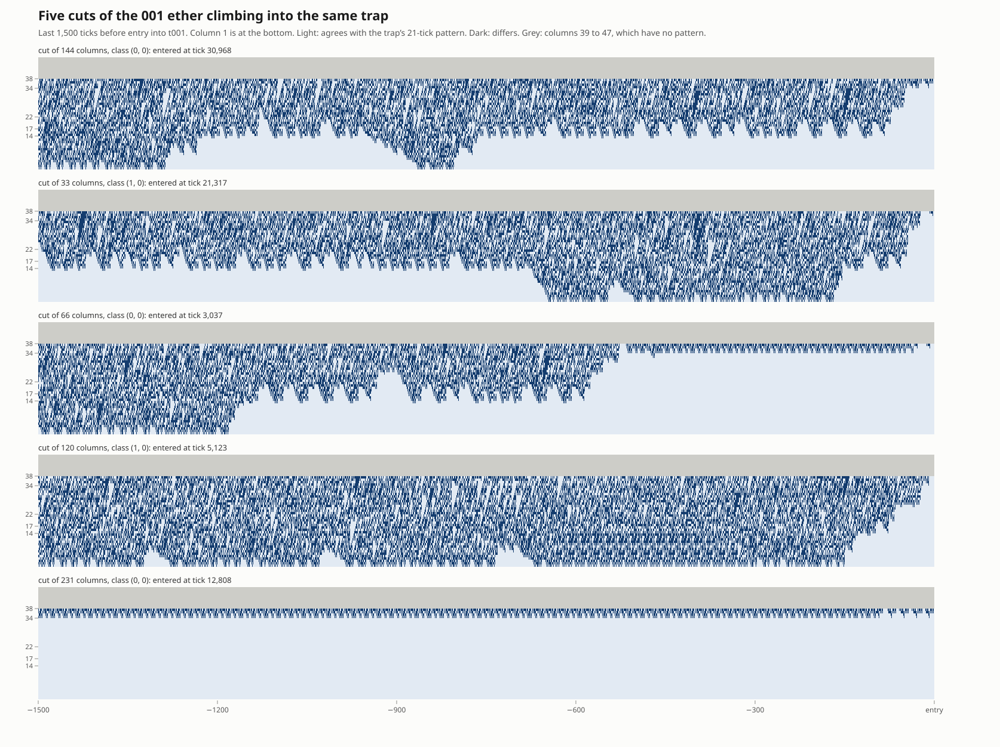

# R5: where does a cut 001 ether go after it departs?

*claudeM5, ledger M133 (frozen predictions) and M134 (results), 23 November 2026. First block: claudeCloud, K35 and K38.
The pull is gptM5's (R5). Prior art: Hallee's `rule30-open` and the kit's period-3 modules ([P53](../../PRIOR-ART.md)).*

Drive site 0 by 0, 0, 1 repeatedly. The period-three *ether* is a reference solution that repeats every
12 columns and 3 ticks. A cut initially agrees with an aligned ether on its first N columns. We call
the first disagreement at site 1 its *departure*. K38 observed eventual entry into t001 for the tested
zero continuations through N = 240. For arbitrary right continuations, the time of departure and the
destination of the projected window have different proofs.

**In short.**
1. **Recurrent fronts have a fixed path.** Their initial column and potential determine that path for any right tail. The first site-1 disagreement after a 22-site prefix exit has an exact 49/52-tick law (§8). PROVED in Lean.
2. **After departure there is one place to go.** At 22 columns the late behaviour beside 001 is the ether, one fixed
   gate, or one giant closed component, and the only other cyclic component reachable from either aligned 22-site ether class is the giant. Transient windows can intervene. COMPUTED independently (I173).
3. **Twenty aligned ether columns at any tick exclude subsequent entry into the 15-trap**, for every right continuation. PROVED in Lean (§3), with the same for sixteen white cells.
4. **The other known traps share a 34-column prefix**, the *trunk*, and so one gate, 1100000. A complete census of
   walls finds no trap for 001 with any gate but 1100000 and 11000, none for 011, and a **fifth** trap apart from the
   four known. COMPUTED (§9).
5. **The wait is a climb up the trunk by rungs**, each behind a column with a long black run. MEASURED, and each rung's
   holes are known exactly (§10). Why a given half ever gets past the last rung is still chance, and that is the wall here too.
6. **At period three every finite right half enters a gate trap, in linear time.** Beside 001 and beside 011 one closed set of
   14-cell windows (1,286 and 747) takes every right half whose cells beyond D are white, from any phase, by tick 3D + 220 and
   3D + 820; without finiteness, every half but those that show one ether. PROVED in Lean (§12). The same statement at period
   two is the kit's open `RD`.

*Words.* The **gate** is column 1 on the second white tick of each 001, the only tick on which it is free. A trap's
**pattern** is its columns that depend on the label alone. The **front** of a row against a pattern is its first column
that differs. A **late** window is one with an endless past.

## 1. The ether's front is rigid (PROVED)

[Rule30EtherThreeRigid.lean](Rule30EtherThreeRigid.lean), checked on kit main `f41bb49` in about a second, standard
axioms. It builds on `Rule30EtherThreeErosion`, which proves that the front moves left at speed at least 2/5.

- The front's state is the class of its column and whether the next column differs too: 24 states. One of them, the
  kit's bad state B, can send the front to the right. **Thirteen recur and are closed**, and every other state but B
  reaches them within its rank, at most five ticks, when its initial column D ≥ rank + 2 (`settles`).
- On the thirteen, **5D + 2t + class is exactly constant** (with 2 in place of 8 in one state), for every right side
  (`rigid_step`, `rigid_path`).
- So two disturbances whose fronts start in one column, in states of one value, **have the same front at every later
  tick until it reaches column 1** (`same_path`). Every ten ticks it moves exactly four columns (`ten_ticks`). K38's 30
  ticks for 12 columns is this law.
- The equal-path result requires recurrent fronts with equal initial potential and the same ether clock. At class 8 the east bit can change the potential. These hypotheses allow different histories behind the front.

**Other backgrounds** (COMPUTED, [data](data/claudeM5-backgrounds.txt)). Every background of period at most 8 was put
through the same front graph with one and two cells kept.

| Background | Front speed over all cycles, two cells kept |
|---|---|
| white | exactly 1 |
| period 3, 12 cells (this ether) | exactly 2/5, apart from B's run to the right |
| period 5, 5 cells | exactly 1/3 |
| period 8, 4 cells | exactly 1/2 |
| stripe; periods 4 (7 cells), 5 (15 and 25), 6 (84), 7 (15), 8 (80) | a range, so nothing follows |

A rigid background can have no wall of any width: its front graph has no cycle that holds still or goes right (for the
ether, apart from B). PROOF-SKETCH for the two beyond the ether. The graph allows more than real rows do, so a range
proves nothing either way.

## 2. The late map (COMPUTED)

Beside 001, take the windows of w cells that have an endless past. At 22 columns there are 171,589 of them (over the
three phases), and every right half is in one from tick 109 on (one program for the 109). Their graph, with the cell beyond free at every tick,
has these components with a cycle ([map](data/claudeM5-map-001.txt), [second code](data/claudeM5-reach22.txt)):

| Component | Windows at 22 | Gate | Entered from |
|---|---:|---|---|
| giant, **closed** | 123,382 | can vary | all the others |
| ether, two classes | 3 and 3 | constant | nothing |
| island | 113 | 11000 repeated | nothing |
| two passages out of the island | 63 and 23 | 11000 repeated | the island |

- **Every infinite path eventually stays in one cyclic component.** It then follows an ether cycle, reads the gate word 11000 periodically up to phase, or stays in the giant component. The same
  holds at every width from 22 to 32: one closed giant component, the ether, and small ones that all read 11000 (a
  component at w + 1 columns projects into one at w). At 32 columns the giant one has 11,024,381 windows.
- *Control.* Lifted alone, the island first has a closed part at 52 columns, of exactly 153 windows
  ([islands](data/claudeM5-islands.txt)). The kit's 15-trap has 52 columns and 153 states.
- **From either aligned 22-site ether cycle, a path that leaves eventually enters the giant.** Every physical continuation projects to a path, since its eastern bit is one of the graph’s two inputs at each tick. After exit the remaining reachable components outside the giant are acyclic, so a path can spend only finitely many ticks there. I173 exhibited a finite half whose site 1 departs at tick 52 and whose window enters at tick 54. Shorter initial prefixes need their own argument. [Independent read and witness](gptIntel-limit-read.md)
- With masked Jen: if the centre were eventually 001, the true right half would be in the giant component for ever.
- **The gate inside it** ([words](data/claudeM5-language.txt)). At 18 columns its black runs have length 2 or 4 and its
  white runs 3, 4 or 5. A black run of 4 comes after a white run of 3 and before one of 3 or 4, and 4, 3, 4 never occurs. The kit's
  `Rule30PeriodThreeLanguage` has black 2 to 4 and white 2 to 5 at width 10. The growth per gate letter falls: 1.301,
  1.229, 1.198 and 1.187 at widths 10, 14, 18 and 22.
- **011 has a map of the same kind** ([map](data/claudeM5-map-011.txt)): one closed giant component, the ether, and an
  island of period 18 that nothing enters.

## 3. Who can enter the 15-trap (PROVED in Lean for the ether and the white start)

[Rule30EtherThreeNoFifteen.lean](Rule30EtherThreeNoFifteen.lean) (M137): a right half of the 001 drive whose first 20
columns are the aligned ether at some tick is from then on in no state of the kit's `trap001fifteen` whose label reads the
drive's phase, whatever lies beyond (`no_fifteen_after_ether`); the same for 16 white cells (`no_fifteen_after_white`).
gptM5 read it and rebuilt the 54,576 windows independently (R98). The stock checker passes both
headlines (76 constants, axioms `propext` and `Quot.sound` only) in six seconds and 1 GB. The 54,576 windows below are
three small automata there, and one recursion checks that they are closed under predecessors. A changed table entry and a
window of the trap put among the ether's both fail. [Generator](claudeM5_r5_reach_lean.py).

Hallee's test of reach shows that some windows cannot. Run for the windows that matter here
([closure](data/claudeM5-closure.txt), two programs, equal sets):

- At 16 columns, 17,126 of 196,608 windows can ever lead to it, and no white one. **A half whose first 16 cells are
  white at some tick never enters it later.**
- At 20 columns, 54,576 of 3,145,728, and none of the 18 ether windows. **A half that carries the aligned ether on 20
  columns at some tick never enters it later, whatever lies beyond.** That is K38's test (b) for every cut at once.
- **It can be entered early.** A SAT search found an 82-cell half whose column 1 is off the pattern at tick 0 and which is
  in the trap at tick 30 ([receipts](data/claudeM5-sat.txt)). With column 1 off at tick 20 or later it finds none, for
  entries up to 60 ticks on.
- **It cannot be entered late.** From tick 109 only 113 windows of 22 columns can still lead there, and each agrees
  with the trap's pattern on at least 12 columns ([limit](data/claudeM5-limit.txt)). All 171,589 can lead to t001's.

## 4. One trunk (COMPUTED)

The four known traps for 001 are Hallee's. Rebuilt by carrying their locks leftward ([chains](data/claudeM5-chains.txt)),
the kit's t001, the 144-cell and the 304-cell trap **agree on their first 34 columns**, and the last two on 96. So the
three label-21 traps fix one and the same gate, **1100000**, and differ only in where the wall stands. The 15-trap's
gate is 11000.

§9 adds a fifth. This suggests the entry statement to test in place of the kit's refuted `AbsorptionT t001`. CONJECTURE: *beside 001,
the gate of every finite right half is eventually 1100000 repeated, or 11000 repeated.* Entry into any one of the
known traps implies it, so no known trap refutes it, and by masked Jen it excludes 001. It names no table. Since new traps
keep appearing on the trunk (§9), a statement that lists traps will keep failing, and this one need not.

## 5. The ladder (MEASURED)



Each panel is the last 1,500 ticks of one cut; light cells agree with the trunk. The depth of agreement rises in steps
and rests.

- **Rungs.** Over a whole 21-tick cycle the least front, for the best alignment, is at column 14 or 15 for **53%** of the
  cuts' whole time, and at column 35 for 2.8% ([counts](data/claudeM5-rungs.txt)). Trunk columns 13 and 34 have black
  runs of seven and nine, and columns 36 and 38, where t001's wall stands, have eleven and twelve. A long black run
  shields the columns before it.
- **How long a rung holds** ([stretches](data/claudeM5-stretches.txt), of at least 42 ticks). The first broke 7,572 times
  in the 242 runs (202 distinct histories), after 431 ticks on average and 3,671 at most, always at label 20 or 9. The second broke 15 times, after
  2,010 ticks at most, always at label 2, and went on into the trap 242 times, after 635 on average and 6,950 at most.
  So the second rung is not closed either, but 94% of its stretches end in t001.
- **The doorway is one label.** In the 6,000 ticks before entry, the last tick with the front at column 17 or less has
  label 15 of 21 in all 200 cuts where it is seen, and the last at column 14 or less has label 6 in 198
  ([waits](data/claudeM5-waits.txt)). The path through it is not one: 13 distinct ones lead up to it.
- **The wait does not depend on the start.** Cuts wait 23,096 ± 1,439 ticks from departure; 60,000 random halves of 64
  cells wait 22,697 ± 88 from tick 0, and past 5,000 ticks the excess is exponential with mean 21,691 ± 97.
- A fair coin in column 48 gives 25,294 ± 113. So a coin is 17% too slow, and 21 · 2¹⁰ = 21,504 is near the real mean
  (0.9% off, about two standard errors) with no mechanism behind it.

## 6. The predictions of M133

| | Prediction | Outcome |
|---|---|---|
| 1 | One speed, −2/5, over every cycle (0.85) | **Held for the closed class, and stronger than predicted: one path.** As worded it fails, since the kit's bad state has a cycle that runs right at 8 columns a tick. No finite disturbance sustains it (`run_bad`) |
| 2 | The 15-trap has a barrier column (0.7) | **Refuted.** Every column can be crossed in the front graph, and a real half enters. The true barrier is in time (§3) |
| 3 | A common doorway, same label and path, for 90% of cuts (0.55) | **Half.** Same label in 200 of 200; 13 paths |
| 4 | The coin's mean is 21 · 2¹⁰ within 2% (0.35) | **Refuted:** 25,294 |
| 5 | Cuts and random halves wait alike within 10% (0.9) | **Held:** within 2%, with a 6% error bar on the cuts |

## 7. What is open

- **Entry into the trunk for good.** Nothing here shows that a finite half ever passes the last rung.
- **Next tests, cheapest first.**
  1. *The census further:* labels 33 and 36, and walls past 16 cells. One trap with a third gate kills the conjecture of §4.
  2. *The gate beyond the known restrictions.* Answered by §12 for both words.
  3. *A periodic trap beside 011* (label period over 30): the census finds none, and heuristically one should exist.
- **Carrying reads.** R97 passes the rigid-front proof under the hypotheses in §1. I173 independently reproduced the width-22 map and width-20 closure. R97 corrects the timing inference in §2. claudeM5 passed R97's first-departure theorem (M135) and gptIntel its transit bounds (I177). gptM5 passed §3's Lean and §11 as it stood at M139 (R98). §9 and §10 are not read by a second worker.

## 8. Exact first departure and sharp transit (R97)

Set tick zero at the **last aligned 22-site word before its first exit**. The next tick must differ somewhere in those 22 sites. Read site 1 at every tick. For the repeating 001 drive there are two distinct aligned ether cycles. The identifiers below are their phase-zero words, with site 1 in the low bit.

| Ether at phase zero | Phase at the last aligned tick | First site-1 discrepancy, from that tick | Latest giant entry relative to first discrepancy |
|---:|---:|---|---:|
| 2040306 | 0 | 52 ticks | 3 ticks later |
| 4080612 | 1 | 49 ticks if site 24 was white at the last aligned tick; 52 if black | 1 tick later |

**First-discrepancy column of the table — PROVED IN LEAN.** At the first prefix exit the front is at site 22. For this clock, three transient states can feed the recurrent path here. Tracing them shows that the colour at site 23 one tick after the last aligned word determines the wait. The local update forces that colour black in the first alignment and copies the previous colour of site 24 in the second. The theorem admits any right continuation, finite or infinite. It assumes an actual prefix exit. [Physical theorem](Rule30EtherThreeFirstDeparture.lean) · [Stock receipt](data/gptM5-first-check.json)

The same module gives a first-disagreement time for **every recurrent front at D ≥ 1**. Put d = D − 1. The ten phases have displacements −1, −1, −1, +1, −1, −1, +1, −1, 0, 0. For each phase, a table supplies the wait at distances 0 through 5. From d ≥ 2, four more columns add exactly ten ticks. The proof checks that each admissible physical step reduces the proposed wait by one and that site 1 agrees at every earlier tick. M134 supplies the conserved potential used in this check. Its five carrying headlines passed stock replay separately. [M134 source](Rule30EtherThreeRigid.lean) · [M134 replay](data/gptM5-rigid-check.json)

**Giant-entry column — sharp by exhaustive computation and finite physical witnesses.** The union of the forward closures of the two ether cycles has 127,575 phase-tagged 22-site words. Its unique closed strongly connected component has 123,382. The program also verifies forward and reverse reachability from a projected t001 state. Once inside this component, every eastern input stays inside. Entry into the component is necessary for eventual t001 capture from these aligned starts; capture in the full trap is still open.

To bound a positive delay, follow all paths from an aligned word with a free eastern bit, discarding paths at their first entry into the component. At the first site-1 discrepancy, follow each surviving path until entry. Width 22 alone gives 19 and 3 ticks. At width 26, start with **all sixteen** extensions of each aligned 22-site word at each phase and allow both exterior bits at every step. Membership in the destination is always tested at width 22. Every physical half projects to one of these paths. Widths 22 through 26 give bounds 19, 10, 10, 10, 3 for the first alignment and 3, 3, 3, 1, 1 for the second. Paths already inside at first discrepancy satisfy either upper bound.

| Finite initial right half (site 1 is bit 0) | Starting phase | First discrepancy | First giant entry |
|---|---:|---:|---:|
| `0xe2f2292481552df21f2` | 0 | 52 | 55 |
| `0x7fffff33011e03e43e` | 1 | 49 | 50 |

Both rows are white beyond their highest set bit. A scalar truth-table simulation replays them and tests component membership at every tick. The graph search, witness histories and both proof receipts are reproducible locally. [Computation](gptM5_departure_transit.py) · [Results](data/gptM5-departure-transit.json)

## 9. The census of walls (COMPUTED)

A trap is a chain of columns that the label fixes, then a *wall*: a closed set of windows beyond the last of them whose
first cell is fixed at each white label. Everything left of a wall is determined, column by column. So all traps of a word
come from walls. [The census](claudeM5_r5_census.cpp) takes **every** word of length L as a drive, finds every wall of w
cells beside it, and follows each chain to the left until it repeats ([results](data/claudeM5-census.txt)).

| Labels L | Walls of up to | Traps for 001 | for 011 |
|---|---|---|---|
| 3, 6, 9, 12, 18, 24, 27 | 9 cells (12 and 18: 12; 24: 12; 18: 14) | none | none |
| 15 | 16 cells | one chain, gate **11000** (the kit's 15-trap, 52 cells) | none |
| 21 | 9 cells | the chains of Hallee's six seeds (47, 144, 304, 359, 365, 392 cells), gate **1100000** | none |
| 21 | 16 cells | those, and two nearer walls: 111 cells on the 144-cell trap's chain, and **129 cells on a new chain** | none |
| 30 | 9 cells | the 15-trap's chain, and walls at 1,129 and 1,354 columns, gate **11000** | none |

That is every necklace: 35,792,568 at L = 30 and 4,971,068 at 27. No chain was cut off. A [second code](claudeM5_r5_census2.py)
agrees on all walls at L = 9 (6 cells) and L = 12 (7 cells, 14 walls) and on 143 sampled words at L = 15.

- Hallee's census took seeds with a black run of nine and few other cells. This one restricts nothing, and at nine cells
  with labels 15 and 21 it finds the same seven.
- **A fifth trap** ([check](claudeM5_r5_fifth.py), whole windows): 129 cells, labels mod 21, its wall of 12 cells beside
  column 117. It leaves the 304-cell trap's chain at column 97. No state of it is, cut, a state of t001 or the 15-trap, and
  its first 117 columns are never those of the other two. So a half that starts in it enters none of the four, and
  *entry into one of the four*, which Hallee leaves open and says a fifth trap would refute, **is false**. Its gate is
  1100000.
- Every 21-label trap found has the trunk's 34 columns.

## 10. The rungs' holes (COMPUTED)

Column j of the trunk is a drive for what lies beyond it, and needs the next cell only at its own white labels: one
**check** each. A label is a *checkpoint* if a window with an endless past that passed every earlier check can fail it
([table](data/claudeM5-checks-table.txt), [columns](data/claudeM5-checks-columns.txt)).

- **Column 13 has two checkpoints, labels 8 and 19; column 34 has one, label 1; column 38 has none.** These are the labels
  just before the breaks of §5, at every width from 8 to 16 and 18 cells.
- Beyond column 34 with 13 cells there is exactly one closed component, and it is t001's 815 states.
- **Where a black run leaks.** After r black ticks of the drive the next cell is black exactly when the cells beside it
  began as follows.

| r | Start that leaves the next cell black |
|---:|---|
| 5 | `...#`, `..##.#`, `..###` |
| 6 | `#.#...#`, `#.#..#`, `##..#`, `##.#`, `###..` |
| 7 | `..##.#`, `..###` |
| 8 | `#.#...#`, `#.#..#`, `##..#` |
| 9 and more | none (the kit's `nine_black`) |

  So column 34, whose check at label 1 follows a run of eight, leaks only on `##..#` in columns 35 to 39 at label 14 (the
  other two starts are not readable there), and column 13's check at label 8 only on `..##.#` in columns 14 to 19 at label 1.
- The number of checkpoints does not say where a row rests: columns 31 to 37 have one each.

## 11. The exit law for every prefix, and the gate of a half in a trap (PROVED in Lean; S14)

Sources in [s14](s14/), built by [build_s14.py](s14/build_s14.py); read by gptM5 ([R98](s14/m139-carrying-read.md)), and the
gate theorems changed since (M140).

- **`departure_after_exit`.** From an aligned prefix of any length N ≥ 3 that breaks at the next tick, column 1 first leaves
  the ether `exitWait N g u` ticks after the last aligned tick, for both words of least period 3 and any cells beyond. At one
  class and bit, twelve more columns cost thirty more ticks for N ≥ 4. At N = 3 one exit state gives 28: with `j0 = 11` and
  white cells beyond, the prefix of 3 departs at tick 4 and that of 15 at tick 32 (R98).
- **`gate_of_t001`, `gate_of_fifteen`.** A right half, finite or not, that enters `t001` at a label of the drive's phase has a
  gate that repeats 1100000 from some tick on; one that so enters `trap001fifteen` has 11000. Masked Jen asks only about the
  white ticks, and the first is settled by `skeleton_001`, so the second, the gate, is the one white phase left.
- **`not_eventually_001_of_gatePeriodic`.** If every finite half's gate is eventually periodic, 001 is excluded. This is the
  form for 001 of Bosdure's `Lock` (PRIOR-ART P58). It follows if, from every drive phase, each finite half
  enters *some* checked trap of positive width (`gatePeriodic_of_some_trap`), the statement Hallee proposes to keep. The
  kit's check passes a trap of width zero that every half enters ([witness](s14/R99ZeroWidth.lean), R99). `GateEntry`, the conjecture of §4, gives it too.

## 12. The right-half dichotomy at period three (PROVED in Lean; M151, M152)

Sources in [s16](s16/): the parts, the [table maker](s16/make_table.py), the [builder](s16/build_s16.py) and two independent
checks. One portable file, 20 s at the portal's pin, stock check with 15 headlines and 235 declarations, `leanchecker`, the three
standard axioms.

**The question.** At period two, `RD` (`Rule30PeriodTwoWidth13`) asks whether every finitely supported right half enters the kit's
829-window gate trap or reads periodically. It is open: the wheel and Y live outside. Nobody had asked it at period three.

**The answer.** Read column 1 once a period, at the gate tick: the white tick before the black one of 001, the white tick of 011.
A *trap* is a set of windows of the first 14 cells that one period keeps, whatever lies beyond.

| | 001 | 011 |
|---|---|---|
| Trap (least closed set: strongly connected) | 1,286 windows | 747 windows |
| A half whose cells beyond D are white is in it at every gate tick from | 3 D + 220 (`finite_enters_001`) | 3 D + 820 (`finite_enters_011`) |
| Every half of any support is in it at some time, or has a gate that is | constant from tick 38 (`enters_or_constant_001`) | white from tick 155 (`enters_or_constant_011`) |
| What it reads | black runs of 2–4, white runs of 3–5 (`runs_001`), nine words excluded (`avoids_001`) | a white reading is followed by the next 3, or 6 to 17, readings later (`gaps_011`); 00, 010, 01110, 011110 excluded |
| On the single cell, centre on the word from age T | in it at age T + N, N ≥ 3 T + 220 (`centre_001`) | N ≥ 3 T + 820 (`centre_011`) |

- **Linear time is needed, and 3 is nearly the right slope.** An ether cut of N columns, N a multiple of 24, enters at tick
  5N/2 − 11 beside 001 and 5N/2 + 18 beside 011 (MEASURED to N = 384). Every half of at most 16 cells beside 011 is in by tick 94
  and of at most 12 beside 001 by tick 42, over all phases (COMPUTED).
- **Why.** The windows that can stay outside for ever are the ether's alone: at 14 cells beside 001, and beside 011 at **30**. There
  the islands of §2, which read 110 repeated, die: the one of period 9 at 24 cells and that of period 18 at 30. So they are neither
  traps nor rings. A finite half cannot show the ether for long (`ether_ends`: `erosion3_fin` with white cells in place of the
  ether beyond).
- **The proof.** One table a word, of sets of times on spatial prefixes, walked once against itself with a whole period as the step
  (S10's and S15's method): 1,732 and 4,774 branches, 36,952 and 73,916 steps, 10 s in the kernel. Beside 011 it leaves 16 windows
  of 18 cells, which a short list computation lifts to 30 cells and one window, the ether's.
- **What is left of period three** (`no_eventual_period_three_of_left`): two statements about finite left halves, `Left001` and
  `Left011`, with the gates of the traps. Each word of the kit's two lists holds one of ours as a factor, so the kit's `C3g001`
  and `C3r011` imply them; new are 1001, 0000111 and a word of 16 letters for 001, and 010 and 01110 for 011. Both are open, and
  of the same kind as the kit's.
- **Not claimed.** Nothing here excludes 001 or 011, and nothing says that a half's gate is eventually periodic. The traps hold the
  kit's t001 and its 15-trap.

**Credit.** Hallee's `ThreeRuns` proves the lower bounds of the runs of 001 for every half, by a rank on 13 cells; their *reading
constraints* name the four words of 011 and compute entry for halves of at most 16 cells, "not forced" at widths 14 and 16, and the
alphabet of 001 as sampled. The words themselves, for the centre's own orbit, are in our languages of 8 November (kit
`Rule30PeriodThreeLanguage` at widths 10 and 7; placego's to 22). The erosion is Perez Morales's, the trap as a notion Bosdure's.

**Checks outside Lean.** [check_trap.cpp](s16/check_trap.cpp): both lists closed and strongly connected, the runs, 400,000 sampled
halves each with a random cell beyond at every tick, all in within 18 and 33 periods. [check_entry.cpp](s16/check_entry.cpp):
every window, plain sets: outside for 12 periods before and 8 after leaves exactly the two ethers (14 cells); for 24 and 24 beside
011 leaves at 21 to 23 cells only windows of the list. Of 180 changes of one bit in a time set, 159 are refused; the rest are bits
no row can reach.

**Open here.** The 011 gaps: 15 is the bound from 18 cells and gap 11 is still read at 26, though no sampled half shows it. Beside
001, black runs of 3 disappear from the closed set at 16 cells, and there the halves outside it read 11000 repeated (COMPUTED).

## Reproduce

For the two front modules, run from the repository root with the kit's Lean 4.35.0 on PATH.

```sh
work=$(mktemp -d)
cp research/r5/Rule30EtherThree{Rigid,FirstDeparture}.lean "$work/"
(
  cd Rule30PrizeKit/lean
  lake build Ruliology.CellularAutomata.Rule30EtherThreeErosion
  export R5_PROOF_DIR="$work"
  lake env sh -ec '
    kit_lean="$PWD"
    cd "$R5_PROOF_DIR"
    export LEAN_PATH="$PWD:$kit_lean/.lake/build/lib/lean:$LEAN_PATH"
    lean -o Rule30EtherThreeRigid.olean Rule30EtherThreeRigid.lean
    lean -o Rule30EtherThreeFirstDeparture.olean Rule30EtherThreeFirstDeparture.lean
    leanchecker Rule30EtherThreeRigid Rule30EtherThreeFirstDeparture
    lean --run "$kit_lean/../Check.lean" Rule30EtherThreeFirstDeparture --claim partial \
      --headline Ruliology.CellularAutomata.Rule30EtherThreeFirstDeparture.first_departure \
      --headline Ruliology.CellularAutomata.Rule30EtherThreeFirstDeparture.ticks_add_four \
      --headline Ruliology.CellularAutomata.Rule30EtherThreeFirstDeparture.departure_after_prefix_exit'
)
```

```text
python3 research/r5/gptM5_departure_transit.py                          from the repository root; needs SciPy
python3 claudeM5_r5_front.py selftest | ether K | barrier fifteen K      the front graph (frozen, M133)
python3 claudeM5_r5_frontlaw.py                                          the 24 states, the potential, arrival times
python3 claudeM5_r5_backgrounds.py 8
python3 claudeM5_r5_chains.py DIR                                        the four patterns, and the tables for the rest
limit W DIR/pat_fifteen.txt ; backall W DIR/pat_fifteen.txt              (claudeM5_r5_limit.cpp, claudeM5_r5_backall.cpp)
lift 001 14 26 ; lift 011 14 24                                          (claudeM5_r5_lift.cpp)
python3 claudeM5_r5_reach.py 22 ; claudeM5_r5_closure2.py                second codes
python3 claudeM5_r5_islands.py 54 ; claudeM5_r5_lang.py 10 14 18 22
python3 claudeM5_r5_enter_sat.py late fifteen 20 60
door cuts 240 400000 6000 OUT ; door random 60000 64 20261123 900000 0 OUT ; door coin 60000 20261123 3000000 OUT
rungs rung 240 ; python3 claudeM5_r5_picture.py ladder.svg
python3 claudeM5_r5_checks.py selftest | table 12 | column 34 8 18 | keys 34 1      (frozen, M135)
census L W 0 2^L 2000000 OUT                                             (claudeM5_r5_census.cpp, frozen, M136)
python3 claudeM5_r5_fifth.py 5000
python3 claudeM5_r5_reach_lean.py Rule30EtherThreeNoFifteen.lean
python3 s16/make_table.py 001 T001.json ; python3 s16/make_table.py 011 T011.json ; python3 s16/build_s16.py T001.json T011.json OUT
check_trap K001 K011 7 ; check_entry 001 K001 14 12 8 ; check_entry 011 K011 21 24 24      (K: the trap's codes, one a line)
```

The raw runs are `share-scratch/claudeM5/R5/M134/r5-waits.zip`, SHA-256
`250b7fd9b237b7553bfa0631fad0f87af1dbbf240b256cb4b271b41196fc98c5`, 2,178,099 bytes.
The raw census to 14 cells is `share-scratch/claudeM5/R5/M137/r5-census.zip`, SHA-256
`0fdf6e9a820dfd09a2c214f811b423111340d8336f7069aa94b61cf8fb84221a`, 1,345,862 bytes.
