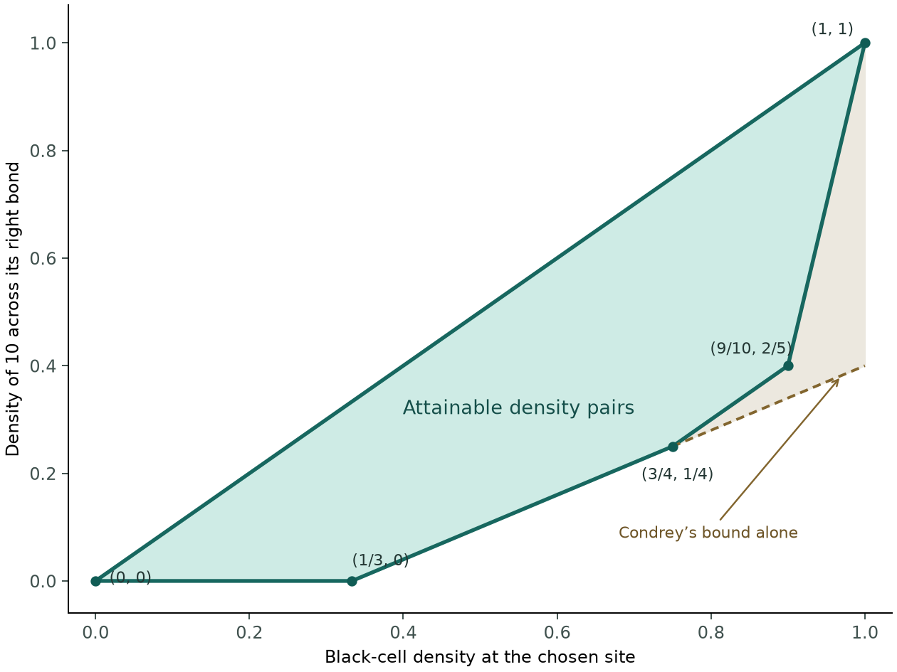

# Which black-cell and source densities can Rule 30 realize?

Fix a site and observe it for T physical ticks. Let C count its black cells and A count the ticks on which it and its right neighbour read 10. In general full-line Rule 30 histories, the possible simultaneous limits of (C/T, A/T) form the closed polygon with the five vertices below. Each vertex has an explicit solution periodic in both space and time. Every point in between has a construction on one infinite history. The particular densities of the singleton remain unknown.

| Black density | 10 density | Witness spatial period | Witness time period |
|---:|---:|---:|---:|
| 0 | 0 | 1 | 1 |
| 1/3 | 0 | 12 | 3 |
| 3/4 | 1/4 | 7 | 4 |
| 9/10 | 2/5 | 155 | 10 |
| 1 | 1 | 2 | 1 |

## The finite inequalities

Every interval of every evolution satisfies 0 ≤ A ≤ C ≤ T and

| Bound | Source |
|---|---|
| 3C ≤ T + 5A + 3 | Condrey, extended to arbitrary onsets by Quint and Gemini |
| 2C ≤ T + 2A + 1 | Horizontal 11 is exactly a black-to-white transition of the right-hand column |
| 6C ≤ 5T + A + 5 | A black run pays for at most five horizontal 11s |

The last bound has a short physical interpretation. During a run of black cells, the right neighbour can be black at most every other tick. After nine black ticks the kit's shield forces it white, and each later tick in that run still has nine preceding black ticks. Each run can therefore contribute at most five horizontal 11s. There are at most T−C+1 black runs. The Lean proof uses a six-site potential so it can also track exactly where slack is lost. Each of the three finite constants is optimal. The time-ten, width-155 example attains them on intervals of three, nine and nine ticks respectively.

After division by T, these bounds describe the polygon exactly. The five periodic solutions certify every supporting linear inequality is optimal, even for uniform estimates over nonzero finite seeds with a fixed additive constant. To see why finite support matters, run a corner for k periods, copy its backward cone to a finite row and place one black cell beyond that cone. An alleged stricter slope fails as k increases. Each individual finite time window can come from a different finite seed.

## A single history for each point

The construction prescribes the chosen site's bit stream and evolves an arbitrary right half under it. The kit's realization theorem supplies one ordinary full-line initial row giving that entire stream. Switching between modes requires a bounded number of ticks. For any target width W, the next W prescribed bits can write any W-site prefix. In chronological order, each new bit chooses the next target site from farthest to nearest. Rule 30 is permutive in its left input, so changing that bit flips precisely the rightmost cell it can reach at the deadline. Later choices cannot reach that cell.

The modes for 0 and 1 use a white centre or a fixed 101 prefix. At the one-third vertex, a 13-state policy at width six chooses the next centre bit before the exterior bit is known. Every allowed successor remains in the policy, no 10 fires, and a bounded potential falls by 3c−1 on every tick. At the other two vertices the checked states are phase-labelled. The width-21 mode has 131 states with counts (3,1) every four ticks. The width-37 mode has 100 states with counts (9,4) every ten ticks. Both remain in their mode for either value of the exterior. They use the width-19 ether prefix and the kit's period-five lock respectively.

Given convex weights wᵢ, in stage m use mode i for floor(m wᵢ) ticks. Every stage has at most five switches, each taking at most 37 ticks, and the discrepancy in each individual mode is bounded independently of its duration. Through k stages the errors from rounding, steering, and incomplete periods are O(k) over k²/2 + O(k) ticks. A partial last stage also contributes O(k). This gives both limits along the whole time axis. The policy closures have an independent, site-by-site replay. The general passage to limits in this paragraph is a mathematical argument.

## What changes on the actual singleton

The two interior corners with black density above one half have a stronger obstruction. At any fixed site j both deficits 2T+7A−5C and 6T+3A−8C grow at least logarithmically. More precisely, start d₀ at |j| and take dₖ₊₁ = 2dₖ+|j|+2p+3. For every T≥dₖ the first deficit is at least k−4 with p=4, and the second is at least k−6 with p=10. Thus an O(1) discrepancy from either corner is impossible. Convergence of the normalized densities to a corner remains possible on this evidence.

In the finite six-site graph, six consecutive zero-loss steps for the first bound force both observed cells at tick one to repeat four ticks later. Twelve such steps for the second force a ten-tick repeat. A sufficiently long stretch would propagate the equalities to the later moving left edge, where the earlier row is still white. This charges one new loss in each stated interval. Lean checks both the small tables and the moving-edge argument.

The middle supporting line meets an existing open question exactly. T−2(C−A) is the number of unchanged transitions in the right column plus the final right bit minus the initial right bit. On the singleton this quantity is bounded above exactly when that column is eventually two-periodic, since a constant tail is excluded by the kit. Proving its divergence at a specified site would exclude period two there.

[Condrey, PR 253](https://github.com/WolframInstitute/Rule30PrizeKit/pull/253) · [Quint and Gemini, PR 297](https://github.com/WolframInstitute/Rule30PrizeKit/pull/297) · [Kit nine-black shield](https://github.com/WolframInstitute/Rule30PrizeKit/blob/40017e8eb17a7cb2eeee1817e2d42241157c71b5/lean/Ruliology/CellularAutomata/Rule30BlackRuns.lean) · [Kit realization theorem](https://github.com/WolframInstitute/Rule30PrizeKit/blob/40017e8eb17a7cb2eeee1817e2d42241157c71b5/lean/Ruliology/CellularAutomata/Rule30Realization.lean)

## Proof and replay

The six Lean sources target official kit commit 40017e8. The checker accepted 26 named headlines and replayed 299 declarations with zero new axioms. To replay the packet, build the kit dependencies Rule30SourceObservables and Rule30Realization, set RULE30_KIT_CHECKOUT to the kit root, and run Python 3 on verify.py with these module names in order: Rule30SourceDensityRegion, Rule30SourceDensityCorners, Rule30DensityEscape, Rule30DensityMargin, Rule30SourceTransitions, Rule30DensitySharpness. The independent policy verifier check-policies.py uses Python 3 without additional packages. The discovery-stage circulation calculations and their floating-point solver are unnecessary for the proofs.
