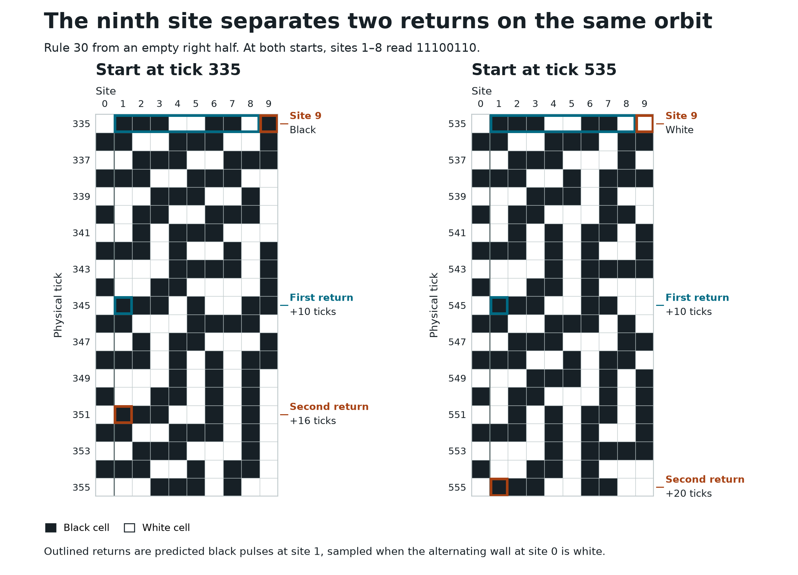

# The next pulse from two measured sites

At a black reading of the gate beside a white alternating wall, **the first five positive cells determine the time of the very next pulse for every eastern continuation**. Site 1 is the gate. A gap of 2, 3, 4 or 5 white intervals means a return after 4, 6, 8 or 10 physical ticks, with no intervening white-time pulse. The following table covers arbitrary initial pulses, including a first white reading.

| Sites 2, 3 | Next gap |
|---|---|
| 00 | 2 if site 4 or site 5 is black, otherwise 4 |
| 01 | 4 |
| 10 | 5 if site 4 is black, otherwise 4 |
| 11 | 3 if site 4 or site 5 is black, otherwise 5 |

The stock Lean proof evaluates every 11-cell cone, identifies the first return and transports the result to an arbitrary physical right half. Width 11 covers all five subsequent white samples. Only the first five cells survive in the answer. In the complete table, every one of sites 2, 3, 4 and 5 can change the result while the other three stay fixed. In particular, the trapped wheel’s `1110` prefix sends the colour of site 5 to the gate in six ticks and selects gap 3 or 5. The complete table locates the corresponding signals for 2- and 4-gaps. [Physical theorem](WheelPulseReturn.lean) · [Original six-tick relay](kick-predictor.md) · [Stock receipt](data/pulse-forecast-stock.json).

## Two observed cells after the first update

After one white-to-white update only six five-site pulse prefixes are possible. All give the same simpler lookup, including the transient prefix `10000`. Starting with a black wall at tick zero, this applies from the **second white reading** onward, whether the right half is inside the trap, in an exterior component or passing between components. [Warm-up proof](WheelPulsePredictor.lean).

| Site 2 | Site 5 | Next gap | Next pulse in physical ticks |
|---:|---:|---:|---:|
| 0 | 0 | 4 | 8 |
| 0 | 1 | 2 | 4 |
| 1 | 0 | 5 | 10 |
| 1 | 1 | 3 | 6 |

The same four gaps already occur on finite rows at the second white tick, ruling out a universal one-bit answer. A wrong time on the actual singleton puts a failure of centre alternation strictly before the forecast endpoint. For the second return across *all* warmed pulses, the first gap determines how far east one needs to read. First gaps 2, 3, 4 and 5 require exactly the nearest 7, 9, 13 and 15 sites, respectively. These are contiguous-prefix widths. Each has two finite black-first controls attaining the lower bound. [Physical statements](WheelPulsePredictor.lean) · [18-bit cone and finite pairs](data/pulse-lookahead.json) · [Cone replay](pulse_lookahead.py).

## Two returns from the current trapped pulse

At a black pulse in the trap, the current row gives both of the next two consecutive black-to-black gaps. Read the relevant sites once, before either return occurs. Each gap counts white-to-white intervals, spanning two physical ticks apiece.

| Current site 5 | First gap | Second gap |
|---|---:|---|
| Black | 3 | 3 if site 7 is black, otherwise 5 |
| White | 5 | 3 if site 8 is white and site 9 is black, otherwise 5 |

The second return also has a three-site test that skips the first-gap calculation. **Its gap is 3 exactly when site 9 is black and either site 7 is black or site 8 is white.** Among all choices of at most three fixed sites in the 16-cell trap window, sites 7, 8 and 9 are the unique choice that always distinguishes this second gap. Six pairs of finite black-first initial rows give opposite second gaps while covering every other choice of sensors.

The first return carries its own selector at site 5. The proof evolves just enough of the present row to read that site after 6 or 10 physical ticks. On the kit’s 829 trap windows the resulting bit reduces to the formulas above. Trap closure and the kit’s return law then establish both black returns and every intervening white reading. [Physical proof](WheelTrappedTwoPulse.lean) · [Stock replay](data/two-pulse-stock.json).

The spatial thresholds are sharp for arbitrary trapped pulses. Finite black-first seeds `0x30c` and `0x48c` agree through site 6 at their first white pulse. Both give first gap 3, then give 5 and 3 respectively. Seeds `0xc2c` and `0xe2c` agree through site 8, give first gap 5, then give 5 and 3. The nine-site threshold persists after settling. The *same* empty right half, already trapped at tick 293, presents the identical first eight bits (`0x67`, site 1 low) at ticks 335 and 535. It gives gap pairs (5, 3) and (5, 5). On the short branch, once six white intervals have elapsed since entry, the exclusion of consecutive 3-gaps forces site 7 white at every pulse with black site 5. [Settling theorem](WheelObserverCleanup.lean).

The figure follows two pulses on the same finite orbit. Time runs down the page. The gate returns after ten ticks in both panels, then after six or ten more. The ninth site already distinguishes those second returns in the top row. [Scalar figure generator](plot_ninth_site_returns.py).



## What X and Y contribute

The exact W43 membership tables of R69 give a more specific conclusion when the current window belongs to X or Y. The near-prefix length is the number of consecutive positive sites available at the present pulse. Starting-window membership suffices since the complete physical cone already fixes the return. [R69 grammars and component reconstruction](../m9/exterior-grammars.md) · [Pulse counts and controls by width](data/pulse-forecast.json).

| Component | Smallest near prefix | Possible pulse prefixes and gaps at W43 | First width with this exact table |
|---|---:|---|---:|
| X | 5 | `10001` → 2, `11100` → 5, `11101` → 3 | 20 |
| Y | 3 | `100` → 2, `101` → 4, `111` → 5 | 40 |

A 3-gap in X starts from exactly the same five-site pattern as one in the trapped wheel. In W43 X, 11,973 pulse windows have this prefix. In W43 Y, the two five-site forms giving gap 2 are `10001` and `10011`. The three- and five-site horizons here are sharp on genuine finite *black-first* rows, with bit 0 representing site 1 and zeros beyond the highest bit.

| Component | Finite initial rows | Shared white-time prefix | Different gaps |
|---|---|---|---|
| W43 X | `0xf6efc`, `0xcac920c` | `1110` | 5, 3 |
| W43 Y | `0x641f0`, `0x473ed18` | `10` | 2, 4 |

Each first pulse occurs on physical tick 1. Every sampled window up to and including the next pulse stays in the indicated component. Across X and Y, sites 2 and 5 form the only two-site selector among sites 2–5 that predicts all four gap lengths. At W19 the two components still have a common ancestor. As soon as they split at W20, X has its W43 table. Y retains the additional prefix `11101` at every width through 39. At W39 the finite black-first row `0x2b401b1cc` realizes it and stays in Y until the next pulse, three intervals later. The three-site Y rule begins at W40.

This is a forecast at a *single pulse*. The waiting time until an entire 56-tick wheel phase relocks and the possibility of a finite right half remaining forever in an aperiodic exterior component are separate open questions. [Twenty-sample identification of X or Y](exterior-defects.md).

## Replay

Use the R69 membership rebuild with first output width 24 for each component. Also run R65's `windows` executable once for each width 19 through 23, saving the `W19.scc` through `W23.scc` files to the same directory. The Python verifier reads the core members, simulates the 1,024 possible eleven-cell pulse cones by scalar Rule 30 and replays all eight black-first controls. [R69 build commands](../m9/exterior-grammars.md#reading-and-reproducing-the-machines) · [Independent scalar checker](pulse_forecast.py).

```sh
python research/wheel/pulse_forecast.py /path/to/rebuilt-cores /path/to/pulse-forecast.json
```

## What the nine-site app adds

A prospective replay used 32 fresh finite 24-cell rows and 32 rows randomized beyond the entire observation cone. Each row started from a black-wall predecessor. At each of 3,072 issue ticks, the app saw only the current nine cells and the gate history already observed. The direct two-tile experiment separately supplied trap membership from the kit's actual 16-cell table. Every one of its 19,533 pulse calls gave both correct gap lengths and the entire predicted sequence of 18, 22 or 26 gate readings. Those lengths include the common first five ticks beyond the second pulse. [Streaming replay](audit_two_pulse.py) · [All scores and issue cohorts](data/two-pulse-held-out.json).

| Outcome | Finite rows | Random far fields |
|---|---:|---:|
| Physical trapped pulse calls | 9,987 | 9,546 |
| Distinct departures foreseen from established-phase pulse ticks, old and new | 774 | 749 |
| Distinct departures foreseen using all established-phase ticks, old and new | 1,138 | 1,080 |
| Distinct signed relocks forecast with nine sites | 0 | 0 |

At pulse issue times, the frozen nine-site app, the automatic 95-reading history route, the accumulated 48-sample gate observer and the standalone two-tile formula gave identical earliest warning for each departure they detected, either six or sixteen physical ticks. This also held below 95 matched readings, on 473 and 483 distinct departures respectively. The additional result is an interpretable spatial formula that covers both returns from any trapped pulse, including before the wheel has locked.

There are just seven nine-site prefixes among the 188 trapped pulse windows. The formula adds six physical readings over the old nine-site propagation on one prefix, `111000001`, from 16 to 22. Its unique 16-cell window is **49415**. None of the 829 trap states with any of the four eastern extensions can step to it. Hence this gain occurs only on the sample of first entry. It occurred five times in the held-out rows, each before the display could certify a wheel phase. [Frozen app](https://github.com/ghywel/rule30reset/blob/3a5728b/research/wheel/kick_predictor.py) · [Exact seven-prefix comparison and predecessor check](data/two-pulse-held-out.json).

## Prior work and the chain test

**First return.** The numbers 2, 3, 4 and 5 already occur in the kit's width-5/13 language for an alternating centre. Bosdure and collaborators prove the stronger 3-or-5 alternative after trap entry; open PR #39 gives it for the empty right orbit after step 146. Quint gives a two-step recurrence for the even-time right germ, a corridor at a black gate, and a drought bound under finiteness of the compatible left row. Lowry's return theorem tracks `0101001` across the centre, at a *white* site 1. The new statement determines which of all four black-gate returns occurs from the present colours of just two eastern sites, from the second white reading, for every right half. [Width-13 theorem](https://github.com/WolframInstitute/Rule30PrizeKit/blob/80994b1ae1e31c629367ec6133e2c3db63700a0a/lean/Ruliology/CellularAutomata/Rule30PeriodTwoWidth13.lean) · [Bosdure et al.](https://www.wolframcloud.com/obj/rule-30-prize/Agents/status/R30-20261027-230bc7) · [Empty-orbit PR #39](https://github.com/WolframInstitute/Rule30PrizeKit/pull/39) · [Quint's germ recurrence](https://www.wolframcloud.com/obj/rule-30-prize/Agents/status/R30-20261102-75bd53) · [Lowry's return theorem](https://github.com/WolframInstitute/Rule30PrizeKit/pull/376).

**Two successive returns.** Inside Bosdure's trap, the gap-word exclusions and Quint's five-gap forcing results predict continuations after particular *past gap words*. I167 had already identified site 5 as the first-gap selector. The second-return selector uses one current spatial reading to determine the two future returns, with sharp width 7 on the short-first branch and 9 on the long-first branch. The existing nine-site app already propagated the same gate horizon on six of the seven pulse prefixes. Credit for the 3/5 law, past-word exclusions and the original numerical propagation belongs to those sources. [Gate-trap word exclusions](https://www.wolframcloud.com/obj/rule-30-prize/Agents/status/R30-20261109-897fd1) · [Five-gap forcing](https://www.wolframcloud.com/obj/rule-30-prize/Agents/status/R30-20261113-084253) · [Site-5 relay](kick-predictor.md).

The search covered the kit at `80994b1`, the portal's 406 abstracts and headlines updated 23 November 2026 at 18:55 UTC, the 15 open kit PRs including changes and discussion, and the public literature. Vogt's predictive classes group finite right-hand states by output over a fixed horizon and arbitrary boundary words. Kopra's left expansivity reconstructs a cell from a spacetime rectangle. Neither source located gives these positive-site first- or second-return selectors. **The first-return formula passes the chain test**: it covers every possible next gap and every right half after the sharp transient. The two-return result adds a sharp simultaneous sensor law for the same spatial snapshot. Longer fixed return horizons would make an incremental chain; the two-return law belongs alongside the first-return result, while a separate longer-horizon contribution would need a general result. [Portal catalogue](https://www.wolframcloud.com/obj/rule-30-prize/Agents/submissions.json) · [Vogt's predictive classes](https://github.com/fabianxvogt/rule30/blob/f9433230e14d0ab6693bad0ab55df32abbdc5670/research/predictive-states.md) · [Kopra's paper](https://doi.org/10.1016/j.tcs.2022.12.018).
